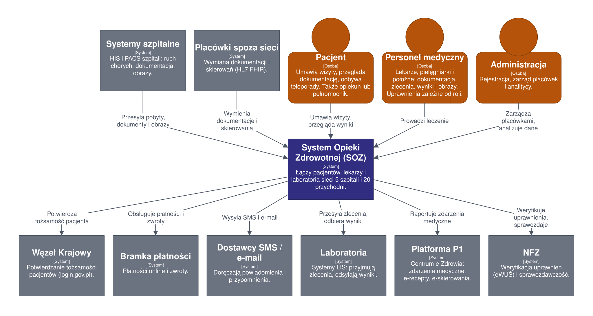
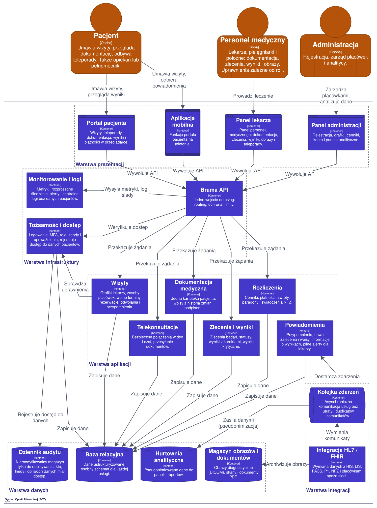
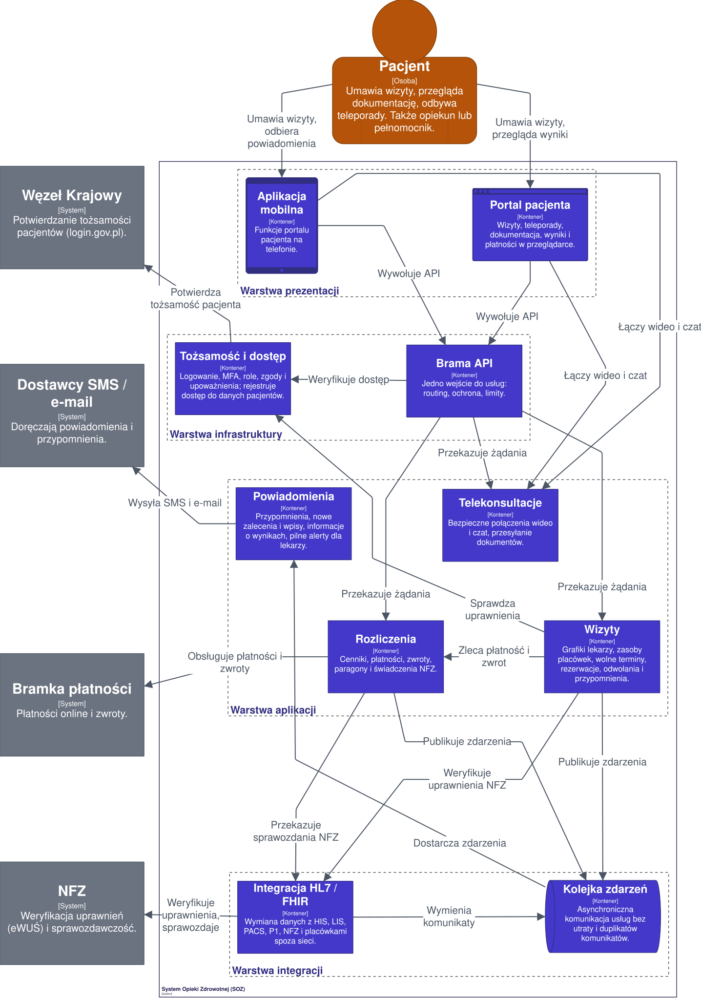
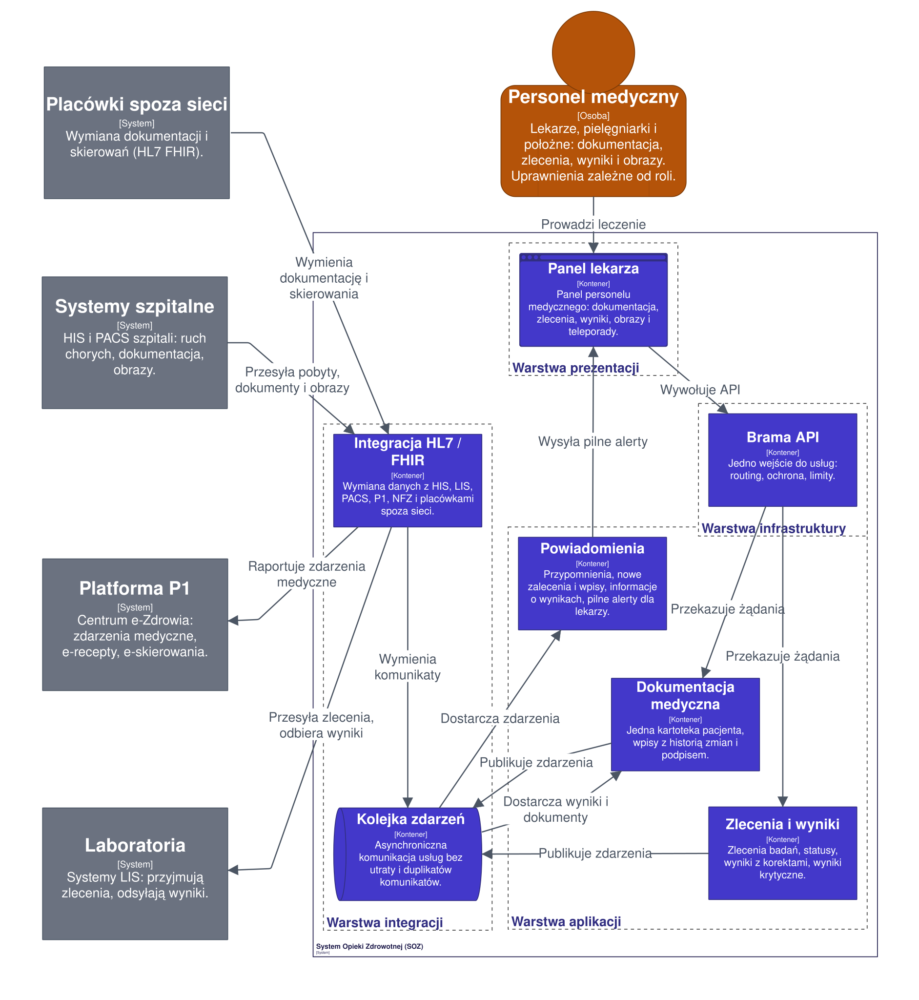
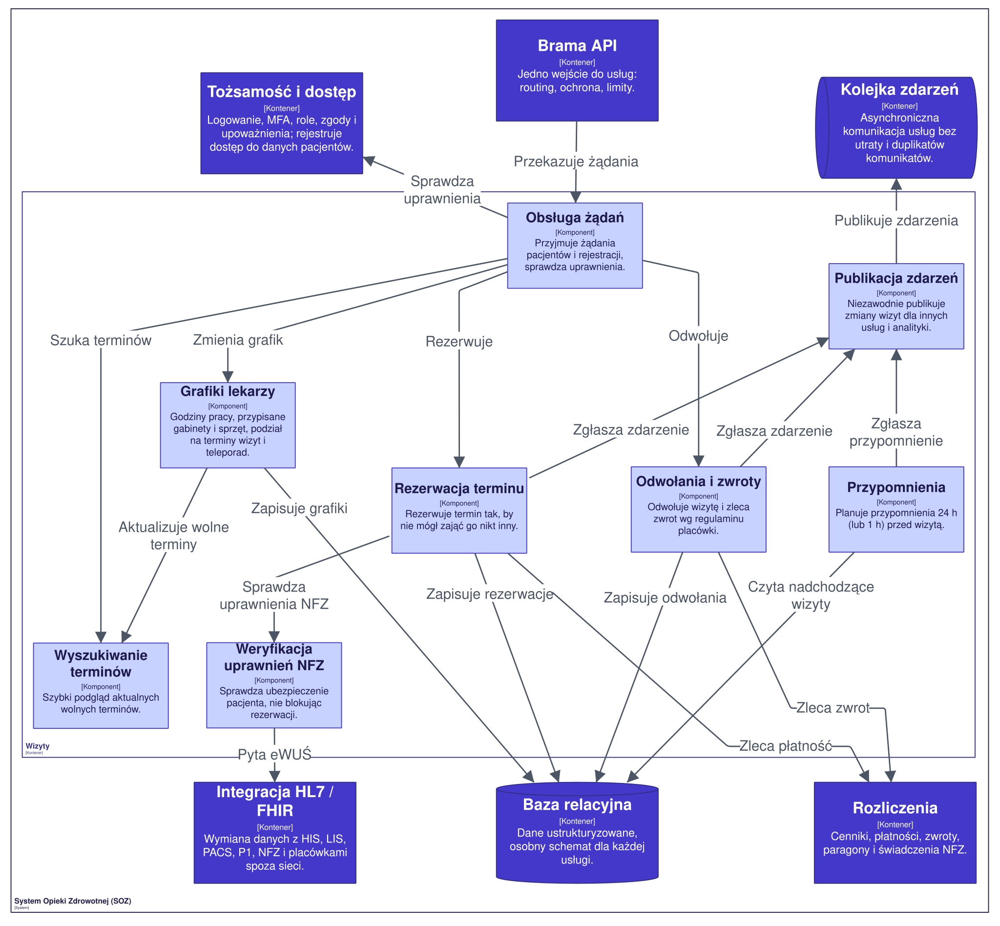

# Projekt System opieki zdrowotnej (SOZ) <!-- omit in toc -->

## Spis treści <!-- omit in toc -->
- [1. Analiza wymagań systemu SOZ](#1-analiza-wymagań-systemu-soz)
  - [1.1. Interesariusze i ich problemy](#11-interesariusze-i-ich-problemy)
    - [1.1.1. Pacjenci](#111-pacjenci)
    - [1.1.2. Lekarze i personel medyczny](#112-lekarze-i-personel-medyczny)
    - [1.1.3. Administracja szpitali i przychodni](#113-administracja-szpitali-i-przychodni)
    - [1.1.4. Organy regulacyjne i instytucje nadzorujące](#114-organy-regulacyjne-i-instytucje-nadzorujące)
  - [1.2. Wymagania funkcjonalne (FR)](#12-wymagania-funkcjonalne-fr)
    - [Aktorzy i obszary wymagań](#aktorzy-i-obszary-wymagań)
    - [1.2.1. Wizyty (FR-WIZ)](#121-wizyty-fr-wiz)
    - [1.2.2. Telekonsultacje (FR-TEL)](#122-telekonsultacje-fr-tel)
    - [1.2.3. Dokumentacja medyczna (FR-DOK)](#123-dokumentacja-medyczna-fr-dok)
    - [1.2.4. Zlecenia i wyniki (FR-ZLE)](#124-zlecenia-i-wyniki-fr-zle)
    - [1.2.5. Integracje zewnętrzne (FR-INT)](#125-integracje-zewnętrzne-fr-int)
    - [1.2.6. Rozliczenia (FR-ROZ)](#126-rozliczenia-fr-roz)
    - [1.2.7. Analityka i raportowanie (FR-ANA)](#127-analityka-i-raportowanie-fr-ana)
    - [1.2.8. Tożsamość, uprawnienia, zgody, audyt (FR-IAM)](#128-tożsamość-uprawnienia-zgody-audyt-fr-iam)
  - [1.3. Wymagania niefunkcjonalne (NFR)](#13-wymagania-niefunkcjonalne-nfr)
    - [Obszary wymagań](#obszary-wymagań)
    - [Klasy usług](#klasy-usług)
    - [1.3.1. Dostępność (NFR-DOS)](#131-dostępność-nfr-dos)
    - [1.3.2. Wydajność i opóźnienia (NFR-WYD)](#132-wydajność-i-opóźnienia-nfr-wyd)
    - [1.3.3. Skalowalność (NFR-SKA)](#133-skalowalność-nfr-ska)
    - [1.3.4. Niezawodność i odtwarzanie po awarii (NFR-NIE)](#134-niezawodność-i-odtwarzanie-po-awarii-nfr-nie)
    - [1.3.5. Bezpieczeństwo (NFR-BEZ)](#135-bezpieczeństwo-nfr-bez)
    - [1.3.6. Zgodność z przepisami (NFR-ZGO)](#136-zgodność-z-przepisami-nfr-zgo)
    - [1.3.7. Interoperacyjność (NFR-IOP)](#137-interoperacyjność-nfr-iop)
    - [1.3.8. Monitorowanie i utrzymanie (NFR-MON)](#138-monitorowanie-i-utrzymanie-nfr-mon)
    - [1.3.9. Użyteczność (NFR-UZY)](#139-użyteczność-nfr-uzy)
  - [1.4. Szacowanie skali systemu (back of the envelope)](#14-szacowanie-skali-systemu-back-of-the-envelope)
    - [1.4.1. Założenia](#141-założenia)
    - [1.4.2. Wolumen dzienny](#142-wolumen-dzienny)
    - [1.4.3. Ruch](#143-ruch)
    - [1.4.4. Dane](#144-dane)
    - [1.4.5. Wpływ wymaganej retencji (NFR-ZGO-02)](#145-wpływ-wymaganej-retencji-nfr-zgo-02)
    - [1.4.6. Sieć](#146-sieć)
    - [1.4.7. Zasoby](#147-zasoby)
    - [1.4.8. Wnioski ze szacowania](#148-wnioski-ze-szacowania)
  - [1.5. Powiązanie problemów interesariuszy z wymaganiami](#15-powiązanie-problemów-interesariuszy-z-wymaganiami)
    - [Pacjenci](#pacjenci)
    - [Lekarze i personel medyczny](#lekarze-i-personel-medyczny)
    - [Administracja szpitali i przychodni](#administracja-szpitali-i-przychodni)
    - [Organy regulacyjne i instytucje nadzorujące](#organy-regulacyjne-i-instytucje-nadzorujące)
- [2. Projekt architektury systemu SOZ](#2-projekt-architektury-systemu-soz)
  - [2.1. Warstwy i główne decyzje architektoniczne](#21-warstwy-i-główne-decyzje-architektoniczne)
  - [2.2. Diagram kontekstu (C4 poziom 1)](#22-diagram-kontekstu-c4-poziom-1)
  - [2.3. Diagram kontenerów (C4 poziom 2)](#23-diagram-kontenerów-c4-poziom-2)
    - [Obsługa pacjenta](#obsługa-pacjenta)
    - [Obsługa kliniczna](#obsługa-kliniczna)
  - [2.4. Diagram komponentów (C4 poziom 3)](#24-diagram-komponentów-c4-poziom-3)

## 1. Analiza wymagań systemu SOZ

Rozdział zawiera analizę wymagań dla Systemu Opieki Zdrowotnej (SOZ), czyli platformy cyfrowej dla grupy medycznej prowadzącej **pięć szpitali** i **20 przychodni**. System ma łączyć pacjentów, personel medyczny i laboratoria diagnostyczne. Ma też obsługiwać telemedycynę, elektroniczną dokumentację medyczną (EDM), wymianę danych laboratoryjnych i panele analityczne, z zachowaniem zgodności z RODO i przepisami o ochronie danych pacjenta.

Rozdział ma następującą strukturę:

1. **1.1 Interesariusze i ich problemy**: kto korzysta z systemu lub ma na niego wpływ i jakie problemy system ma rozwiązać.
2. **1.2 Wymagania funkcjonalne (FR)**: co system musi robić.
3. **1.3 Wymagania niefunkcjonalne (NFR)**: jakie cechy jakościowe system musi spełniać.
4. **1.4 Szacowanie skali systemu**: obliczenia „back of the envelope”, które pokazują rząd wielkości ruchu, danych i zasobów.
5. **1.5 Powiązanie problemów interesariuszy z wymaganiami**: macierz pokazująca, które wymagania odpowiadają na które problemy.

---

### 1.1. Interesariusze i ich problemy

| Interesariusz                               | Rola w systemie                                                                   | Główny kanał dostępu                             |
| ------------------------------------------- | --------------------------------------------------------------------------------- | ------------------------------------------------ |
| Pacjenci                                    | Główni użytkownicy usług medycznych                                               | Portal internetowy, aplikacja mobilna            |
| Lekarze i personel medyczny                 | Użytkownicy profesjonalni: diagnoza, leczenie, opieka pielęgniarska, dokumentacja | Panel lekarza (panel personelu medycznego)       |
| Administracja szpitali i przychodni         | Zarządzanie placówkami, zasobami i finansami                                      | Panel administracyjny, panele analityczne        |
| Organy regulacyjne i instytucje nadzorujące | Nadzór nad ochroną danych i bezpieczeństwem informacji                            | Pośrednio: audyt, raporty, zgłoszenia incydentów |

Poza czterema powyższymi grupami interesariuszy w wymaganiach funkcjonalnych występują też **aktorzy systemowi**: laboratoria (systemy LIS), pracownie diagnostyki obrazowej (PACS), szpitalne systemy HIS, krajowa platforma e-zdrowia (P1), NFZ oraz placówki spoza sieci (zob. 1.2).

#### 1.1.1. Pacjenci

**Rola w systemie**

Główni użytkownicy platformy. Korzystają z portalu internetowego lub aplikacji mobilnej, aby zarządzać swoim procesem leczenia i uzyskiwać dostęp do usług medycznych.

**Główne problemy pacjentów:**

1. **Trudności z umawianiem wizyt**: konieczność telefonowania do przychodni, długie kolejki i ograniczona dostępność terminów.
2. **Rozproszenie dokumentacji medycznej**: wyniki badań, historia leczenia i dokumentacja znajdują się w różnych placówkach.
3. **Brak łatwego dostępu do wyników badań**: pacjenci muszą czekać na wyniki lub odbierać je osobiście.
4. **Ograniczony dostęp do lekarzy**: konieczność osobistego przyjazdu do placówki nawet w przypadku konsultacji, które mogłyby odbyć się zdalnie.
5. **Brak przejrzystej informacji o leczeniu**: trudności ze śledzeniem historii wizyt, zaleceń i kolejnych etapów leczenia.
6. **Obawy o bezpieczeństwo danych**: ryzyko nieuprawnionego dostępu do prywatnych informacji medycznych.

**Potrzeby pacjentów:**

- Możliwość rezerwowania i odwoływania wizyt online.
- Dostęp do własnej dokumentacji medycznej.
- Szybkie otrzymywanie wyników badań laboratoryjnych.
- Możliwość odbywania konsultacji lekarskich online.
- Bezpieczne logowanie i ochrona danych osobowych.
- Powiadomienia o wizytach, wynikach i zaleceniach lekarskich.

#### 1.1.2. Lekarze i personel medyczny

**Rola w systemie**

Użytkownicy profesjonalni odpowiedzialni za diagnozowanie, leczenie pacjentów, prowadzenie dokumentacji medycznej oraz podejmowanie decyzji klinicznych. Do tej grupy należą lekarze (ok. 1050 osób) oraz pielęgniarki i położne (ok. 2300 osób). Te ostatnie są najliczniejszą grupą użytkowników systemu, bo prowadzą dokumentację pielęgniarską, realizują zlecenia i pracują zmianowo przez całą dobę. Z panelu personelu medycznego korzystają obie grupy, z uprawnieniami zależnymi od roli (FR-IAM-02).

**Główne problemy lekarzy:**

1. **Rozproszona dokumentacja medyczna**: brak jednego miejsca, w którym można znaleźć pełną historię leczenia pacjenta.
2. **Czasochłonne czynności administracyjne**: ręczne wprowadzanie danych, uzupełnianie dokumentacji i obsługa wielu systemów informatycznych.
3. **Problemy z dostępem do wyników badań**: konieczność korzystania z różnych systemów laboratoryjnych i diagnostycznych.
4. **Brak integracji między placówkami**: trudności w wymianie informacji o pacjentach pomiędzy szpitalami i przychodniami.
5. **Ograniczona możliwość konsultacji zdalnych**: brak jednolitego narzędzia do telekonsultacji, które zapewnia poufność przekazywanych informacji.
6. **Ryzyko błędów medycznych**: niekompletne informacje o pacjencie mogą utrudniać postawienie prawidłowej diagnozy.

**Potrzeby lekarzy:**

- Szybki i bezpieczny dostęp do historii choroby pacjenta.
- Dostęp do wyników laboratoryjnych i badań obrazowych.
- Zintegrowana elektroniczna dokumentacja medyczna (EDM).
- Możliwość prowadzenia konsultacji online za pomocą narzędzia gwarantującego poufność przekazywanych danych.
- Automatyzacja wybranych czynności administracyjnych.
- Czytelny i intuicyjny panel lekarza.
- Kontrola dostępu do danych zgodnie z uprawnieniami.

#### 1.1.3. Administracja szpitali i przychodni

**Rola w systemie**

Osoby zarządzające placówkami, personelem, zasobami, harmonogramami, finansami i procesami operacyjnymi.

**Główne problemy administracji:**

1. **Brak centralnego zarządzania**: pięć szpitali i 20 przychodni może korzystać z różnych systemów, co utrudnia koordynację działalności.
2. **Problemy z planowaniem zasobów**: trudności w zarządzaniu dostępnością lekarzy, gabinetów, sprzętu i terminów.
3. **Niewystarczający dostęp do danych operacyjnych**: brak aktualnych informacji o liczbie pacjentów, obłożeniu placówek i wykorzystaniu zasobów.
4. **Nieefektywne procesy administracyjne**: ręczne przetwarzanie danych i powielanie tych samych informacji w różnych systemach.
5. **Trudności w analizie kosztów i wydajności**: brak jednolitych raportów dotyczących działalności poszczególnych placówek.
6. **Wysokie koszty utrzymania infrastruktury IT**: konieczność utrzymywania i integrowania wielu niezależnych rozwiązań.

**Potrzeby administracji:**

- Centralny system zarządzania placówkami.
- Zarządzanie harmonogramami personelu i dostępnością usług.
- Panele analityczne i raporty operacyjne.
- Monitorowanie obłożenia szpitali i przychodni.
- Usprawnienie procesów administracyjnych i rozliczeniowych.
- Możliwość porównywania efektywności poszczególnych placówek.
- Skalowalna infrastruktura umożliwiająca rozwój systemu.

#### 1.1.4. Organy regulacyjne i instytucje nadzorujące

**Rola w systemie**

Instytucje odpowiedzialne za nadzór nad przestrzeganiem przepisów dotyczących ochrony danych osobowych, bezpieczeństwa informacji i funkcjonowania systemu opieki zdrowotnej (m.in. UODO, Ministerstwo Zdrowia, Centrum e-Zdrowia, NFZ).

**Główne problemy i wyzwania organów regulacyjnych:**

1. **Ochrona danych osobowych**: dane medyczne należą do szczególnych kategorii danych osobowych i wymagają odpowiedniego poziomu ochrony.
2. **Ryzyko nieuprawnionego dostępu**: konieczność zapobiegania dostępowi do dokumentacji medycznej przez osoby nieuprawnione.
3. **Brak pełnej identyfikowalności operacji**: potrzeba sprawdzenia, kto, kiedy i w jakim celu uzyskał dostęp do danych.
4. **Bezpieczeństwo wymiany danych**: konieczność zapewnienia poufności i integralności danych przesyłanych między szpitalami, przychodniami i laboratoriami.
5. **Zarządzanie incydentami bezpieczeństwa**: konieczność wykrywania naruszeń, dokumentowania ich i odpowiedniego reagowania.

**Potrzeby organów regulacyjnych:**

- Mechanizmy uwierzytelniania i autoryzacji użytkowników.
- Szyfrowanie danych podczas przesyłania i przechowywania.
- Rejestrowanie operacji w dziennikach audytowych.
- Możliwość kontroli dostępu do dokumentacji medycznej.
- Zapewnienie integralności i poufności informacji.
- Procedury reagowania na incydenty bezpieczeństwa.

---

### 1.2. Wymagania funkcjonalne (FR)

#### Aktorzy i obszary wymagań

Aktorzy systemu:

1. Pacjenci
2. Lekarze, pielęgniarki i pozostały personel medyczny
3. Laboratoria
4. Zewnętrzne placówki i systemy (integracja przez standardy HL7 i FHIR)
5. Administracja placówki

Na podstawie potrzeb interesariuszy oraz głównych celów systemu zdefiniowano osiem obszarów wymagań funkcjonalnych:

| Obszar                               | Prefiks | Liczba wymagań |
| ------------------------------------ | ------- | -------------- |
| Wizyty                               | FR-WIZ  | 10             |
| Telekonsultacje                      | FR-TEL  | 9              |
| Dokumentacja medyczna                | FR-DOK  | 7              |
| Zlecenia i wyniki                    | FR-ZLE  | 7              |
| Integracje zewnętrzne                | FR-INT  | 6              |
| Rozliczenia                          | FR-ROZ  | 6              |
| Analityka i raportowanie             | FR-ANA  | 6              |
| Tożsamość, uprawnienia, zgody, audyt | FR-IAM  | 6              |

#### 1.2.1. Wizyty (FR-WIZ)

- **FR-WIZ-01**: Pacjent musi mieć możliwość umówienia wizyty przez stronę internetową lub aplikację.
- **FR-WIZ-02**: System musi wysłać pacjentowi przypomnienie na 24 h przed wizytą.
- **FR-WIZ-03**: System musi wyświetlić aktualny grafik lekarza przy umawianiu wizyty.
- **FR-WIZ-04**: System musi zarezerwować wybrany termin w chwili potwierdzenia wizyty i uniemożliwić jego ponowną rezerwację przez innego pacjenta.
- **FR-WIZ-05**: Pacjent musi mieć możliwość odwołania wizyty przez stronę internetową lub aplikację.
- **FR-WIZ-06**: System musi umożliwiać wprowadzenie wizyty przez personel placówki w przypadku umówienia wizyty telefonicznie lub w placówce.
- **FR-WIZ-07**: System musi umożliwiać odwołanie wizyty przez personel placówki (np. lekarza).
- **FR-WIZ-08**: System musi umożliwiać zarządzanie grafikiem lekarza poprzez wprowadzanie jego godzin pracy.
- **FR-WIZ-09**: System musi udostępniać aktualne dane o statusie wizyt na potrzeby analityki.
- **FR-WIZ-10**: System musi umożliwiać administracji placówki zarządzanie zasobami (gabinety, sprzęt diagnostyczny) i przypisywanie ich do grafików lekarzy.

#### 1.2.2. Telekonsultacje (FR-TEL)

- **FR-TEL-01**: Pacjent musi mieć możliwość umówienia telekonsultacji przez stronę internetową lub aplikację.
- **FR-TEL-02**: System musi wysłać pacjentowi przypomnienie na 24 h przed teleporadą lub na 1 h przed nią, jeżeli teleporada jest umawiana tego samego dnia.
- **FR-TEL-03**: System musi wyświetlić aktualny grafik lekarza przy umawianiu teleporady.
- **FR-TEL-04**: Pacjent musi mieć możliwość odwołania teleporady przez stronę internetową lub aplikację.
- **FR-TEL-05**: System musi umożliwiać odwołanie teleporady przez personel placówki (np. lekarza).
- **FR-TEL-06**: System musi umożliwiać bezpieczne przesyłanie dokumentacji medycznej w trakcie teleporady.
- **FR-TEL-07**: System musi umożliwiać zarządzanie grafikiem lekarza przez wprowadzenie jego godzin pracy przeznaczonych na teleporady.
- **FR-TEL-08**: System musi udostępniać aktualne dane o statusie teleporad na potrzeby analityki.
- **FR-TEL-09**: System musi umożliwiać przeprowadzenie teleporady poprzez połączenie wideo lub czat w aplikacji lub na stronie internetowej.

#### 1.2.3. Dokumentacja medyczna (FR-DOK)

- **FR-DOK-01**: System musi umożliwiać pacjentowi dostęp do jego dokumentacji medycznej poprzez stronę internetową lub aplikację.
- **FR-DOK-02**: System musi prowadzić jedną kartotekę pacjenta i rozpoznawać pacjenta zarejestrowanego wcześniej w innej placówce (np. po numerze PESEL).
- **FR-DOK-03**: System musi umożliwiać lekarzowi dostęp do dokumentacji medycznej pacjenta i dodawanie do niej nowych wpisów.
- **FR-DOK-04**: System musi umożliwiać lekarzowi tworzenie dokumentacji (np. karta wizyty, zlecenia) i podpisywanie jej cyfrowo.
- **FR-DOK-05**: System musi przedstawiać lekarzowi podsumowanie informacji o pacjencie, zawierające m.in. informacje o alergiach, chorobach przewlekłych i lekach przyjmowanych na stałe.
- **FR-DOK-06**: System musi umożliwiać lekarzowi wprowadzanie korekt do dokumentacji medycznej, jednocześnie przechowując historię zmian.
- **FR-DOK-07**: System musi powiadamiać pacjenta o nowych zaleceniach lekarskich i nowych wpisach w jego dokumentacji (np. po zakończeniu wizyty lub wypisie ze szpitala), z wykorzystaniem kanałów wybranych przez pacjenta (FR-IAM-05).

#### 1.2.4. Zlecenia i wyniki (FR-ZLE)

- **FR-ZLE-01**: System musi umożliwiać lekarzowi wystawienie zlecenia badania laboratoryjnego i przekazanie go do laboratorium.
- **FR-ZLE-02**: System musi umożliwiać lekarzowi wystawienie zlecenia badania obrazowego (np. RTG, TK, MRI).
- **FR-ZLE-03**: System musi umożliwiać laboratorium przyjęcie zlecenia, przesłanie wyniku badania oraz jego korektę, z zachowaniem poprzedniej wersji wyniku.
- **FR-ZLE-04**: System musi umożliwiać lekarzowi oraz pacjentowi śledzenie statusu zlecenia.
- **FR-ZLE-05**: System musi powiadamiać lekarza zlecającego oraz pacjenta o dostępności wyniku badania. Wyniki wybranych rodzajów badań (np. histopatologicznych) są udostępniane pacjentowi dopiero po zatwierdzeniu przez lekarza.
- **FR-ZLE-06**: System musi niezwłocznie powiadomić lekarza zlecającego w trybie pilnym o wyniku oznaczonym przez laboratorium jako krytyczny.
- **FR-ZLE-07**: System musi umożliwiać lekarzowi przeglądanie wyników badań laboratoryjnych, obrazów oraz opisów badań obrazowych, w tym porównanie wyników tego samego badania w czasie.

#### 1.2.5. Integracje zewnętrzne (FR-INT)

- **FR-INT-01**: System musi odbierać z systemów HIS szpitali informacje o przyjęciach i wypisach pacjentów oraz dokumentację medyczną powstałą w HIS.
- **FR-INT-02**: System musi przekazywać zlecenia badań do systemów LIS laboratoriów oraz odbierać z nich wyniki badań.
- **FR-INT-03**: System musi odbierać z systemów PACS placówek obrazy i opisy badań obrazowych i przechowywać je w centralnym archiwum dostępnym dla wszystkich placówek sieci.
- **FR-INT-04**: System musi przekazywać do krajowej platformy e-zdrowia (P1) informacje o zdarzeniach medycznych, e-recepty i e-skierowania.
- **FR-INT-05**: System musi weryfikować w systemach NFZ uprawnienia pacjenta do świadczeń finansowanych ze środków publicznych oraz przekazywać dane rozliczeniowe do NFZ.
- **FR-INT-06**: System musi umożliwiać wymianę dokumentacji medycznej i skierowań z placówkami spoza sieci z wykorzystaniem standardów HL7 i FHIR.

#### 1.2.6. Rozliczenia (FR-ROZ)

- **FR-ROZ-01**: System musi umożliwiać administracji placówek zarządzanie cennikiem usług płatnych (wizyty, teleporady, badania), z możliwością różnicowania cen między placówkami.
- **FR-ROZ-02**: System musi umożliwiać pacjentowi opłacenie wizyty prywatnej online podczas jej umawiania lub w placówce.
- **FR-ROZ-03**: System musi automatycznie zlecać zwrot płatności w przypadku odwołania opłaconej wizyty zgodnie z regulaminem placówki.
- **FR-ROZ-04**: System musi wystawiać pacjentowi dokument sprzedaży (paragon lub fakturę) za opłaconą usługę i udostępniać go w portalu pacjenta.
- **FR-ROZ-05**: System musi rejestrować świadczenia udzielone w ramach NFZ i przygotowywać na ich podstawie dane sprawozdawcze do przekazania do NFZ.
- **FR-ROZ-06**: System musi umożliwiać administracji przeglądanie zestawień przychodów i rozliczeń z podziałem na placówki, okresy i źródło finansowania (NFZ, prywatne).

#### 1.2.7. Analityka i raportowanie (FR-ANA)

- **FR-ANA-01**: System musi udostępniać zarządowi i administracji placówek panel operacyjny z informacjami o liczbie wizyt, obłożeniu gabinetów i łóżek oraz czasie oczekiwania na wizytę, z podziałem na placówki.
- **FR-ANA-02**: System musi prezentować statystyki wizyt odwołanych oraz nieodbytych z powodu nieobecności pacjenta.
- **FR-ANA-03**: System musi prezentować wskaźniki wyników leczenia, np. odsetek ponownych hospitalizacji w ciągu 30 dni od wypisu.
- **FR-ANA-04**: System musi umożliwiać filtrowanie danych w panelach według placówki, okresu i specjalizacji oraz eksport raportów.
- **FR-ANA-05**: System musi automatycznie generować raporty cykliczne i udostępniać je uprawnionym odbiorcom.
- **FR-ANA-06**: System musi prezentować dane analityczne wyłącznie w postaci zagregowanej lub pseudonimizowanej, bez danych umożliwiających identyfikację pacjenta.

#### 1.2.8. Tożsamość, uprawnienia, zgody, audyt (FR-IAM)

- **FR-IAM-01**: System musi umożliwiać pacjentowi założenie konta i logowanie z potwierdzeniem tożsamości (np. przez krajowy węzeł identyfikacji elektronicznej).
- **FR-IAM-02**: System musi umożliwiać administratorowi zarządzanie kontami personelu oraz przypisywanie im ról (np. lekarz, pielęgniarka, rejestracja, laborant, analityk, administrator) i placówek.
- **FR-IAM-03**: System musi udzielać personelowi medycznemu dostępu do dokumentacji tylko tych pacjentów, którym udziela on świadczeń.
- **FR-IAM-04**: System musi umożliwiać pacjentowi upoważnienie innych osób do dostępu do jego dokumentacji oraz odwołanie upoważnienia, a opiekunowi prawnemu działanie w imieniu podopiecznego.
- **FR-IAM-05**: System musi umożliwiać pacjentowi składanie i wycofywanie zgód oraz oświadczeń (np. zgody na teleporadę, na kanały powiadomień).
- **FR-IAM-06**: System musi rejestrować każdy dostęp do dokumentacji medycznej oraz udostępniać pacjentowi historię dostępu do jego dokumentacji.

---

### 1.3. Wymagania niefunkcjonalne (NFR)

#### Obszary wymagań

Na podstawie głównych celów systemu zdefiniowano dziewięć obszarów wymagań niefunkcjonalnych:

| Obszar                               | Prefiks |
| ------------------------------------ | ------- |
| Dostępność                           | NFR-DOS |
| Wydajność i opóźnienia               | NFR-WYD |
| Skalowalność                         | NFR-SKA |
| Niezawodność i odtwarzanie po awarii | NFR-NIE |
| Bezpieczeństwo                       | NFR-BEZ |
| Zgodność z przepisami                | NFR-ZGO |
| Interoperacyjność                    | NFR-IOP |
| Monitorowanie i utrzymanie           | NFR-MON |
| Użyteczność                          | NFR-UZY |

#### Klasy usług

Wymagania dotyczące dostępności i odtwarzania po awarii określono dla trzech klas usług:

| Klasa                               | Usługi                                                                                                                    | Dostępność                     | RPO   | RTO  |
| ----------------------------------- | ------------------------------------------------------------------------------------------------------------------------- | ------------------------------ | ----- | ---- |
| **K1 - usługi kliniczne krytyczne** | dokumentacja medyczna, zlecenia i wyniki badań (w tym powiadomienia o wynikach krytycznych), integracja z HIS, LIS i PACS | 99,95% (24/7)                  | 5 min | 1 h  |
| **K2 - usługi dla pacjentów**       | portal i aplikacja mobilna, wizyty, telekonsultacje, powiadomienia dla pacjentów, płatności                               | 99,9% (24/7)                   | 5 min | 4 h  |
| **K3 - usługi wspierające**         | rozliczenia z NFZ, analityka i raportowanie                                                                               | 99,5% (dni robocze 7:00-19:00) | 24 h  | 24 h |

#### 1.3.1. Dostępność (NFR-DOS)

- **NFR-DOS-01**: Usługi K1 muszą być dostępne w trybie 24/7 na poziomie co najmniej 99,95% w skali miesiąca.
- **NFR-DOS-02**: Usługi K2 muszą być dostępne w trybie 24/7 na poziomie co najmniej 99,9% w skali miesiąca.
- **NFR-DOS-03**: Usługi K3 muszą być dostępne na poziomie co najmniej 99,5% w dni robocze w godzinach 7:00-19:00.
- **NFR-DOS-04**: Awaria jednej usługi (np. rozliczeń lub analityki) nie może powodować niedostępności pozostałych usług.
- **NFR-DOS-05**: Wdrażanie nowych wersji i prace serwisowe nie mogą powodować przerw w działaniu usług K1 i K2.
- **NFR-DOS-06**: W przypadku utraty łączności z platformą placówka musi mieć w trybie awaryjnym dostęp do listy wizyt i podstawowych danych pacjentów na bieżący dzień.

#### 1.3.2. Wydajność i opóźnienia (NFR-WYD)

- **NFR-WYD-01**: Czas odpowiedzi systemu na typowe operacje (np. wyświetlenie grafiku lekarza, listy wizyt) nie może przekraczać 1 s dla 95% żądań.
- **NFR-WYD-02**: Otwarcie dokumentacji medycznej pacjenta przez lekarza nie może trwać dłużej niż 2 s dla 95% żądań, niezależnie od placówki, w której dokumentacja powstała.
- **NFR-WYD-03**: Powiadomienie lekarza o wyniku krytycznym musi zostać dostarczone w ciągu 60 s, a pozostałe wyniki muszą być widoczne w dokumentacji w ciągu 5 min od odebrania z laboratorium.
- **NFR-WYD-04**: Telekonsultacje wideo muszą zapewniać opóźnienie transmisji nie większe niż 300 ms oraz automatycznie dostosowywać jakość obrazu do przepustowości łącza.
- **NFR-WYD-05**: Pierwszy obraz badania obrazowego musi zostać wyświetlony lekarzowi w ciągu 3 s.
- **NFR-WYD-06**: Dane w panelach analitycznych muszą być aktualne z opóźnieniem nie większym niż 15 min, a zapytania analityczne nie mogą obniżać wydajności pozostałych usług.

#### 1.3.3. Skalowalność (NFR-SKA)

- **NFR-SKA-01**: System musi obsłużyć obciążenie szczytowe równe co najmniej 3-krotności średniego obciążenia dziennego bez pogorszenia czasów odpowiedzi.
- **NFR-SKA-02**: System musi umożliwiać niezależne skalowanie horyzontalne poszczególnych usług bez przerywania pracy systemu.
- **NFR-SKA-03**: System musi automatycznie dostosowywać przydzielone zasoby do bieżącego obciążenia (autoskalowanie).
- **NFR-SKA-04**: Dołączenie nowej placówki musi być możliwe poprzez konfigurację, bez zmian w kodzie i bez przerwy w działaniu systemu.
- **NFR-SKA-05**: Architektura systemu musi umożliwiać obsłużenie 2-krotnego wzrostu liczby pacjentów i wolumenu danych w ciągu 5 lat wyłącznie poprzez dodanie zasobów.

#### 1.3.4. Niezawodność i odtwarzanie po awarii (NFR-NIE)

- **NFR-NIE-01**: System musi działać w co najmniej dwóch strefach dostępności regionu podstawowego oraz posiadać region zapasowy na terenie EOG.
- **NFR-NIE-02**: Maksymalna utrata danych (RPO) po awarii regionu nie może przekraczać 5 min dla usług K1 i K2 oraz 24 h dla usług K3.
- **NFR-NIE-03**: Maksymalny czas przywrócenia działania (RTO) po awarii regionu nie może przekraczać 1 h dla usług K1, 4 h dla usług K2 i 24 h dla usług K3.
- **NFR-NIE-04**: Kopie zapasowe muszą być wykonywane automatycznie co najmniej raz na dobę, szyfrowane, przechowywane w odrębnej lokalizacji i zabezpieczone przed modyfikacją.
- **NFR-NIE-05**: Odtwarzanie z kopii zapasowych musi być testowane co najmniej raz na kwartał, a przełączenie na region zapasowy co najmniej dwa razy w roku.
- **NFR-NIE-06**: Komunikaty wymieniane między usługami i z systemami zewnętrznymi (zlecenia, wyniki, płatności) nie mogą zostać utracone ani przetworzone wielokrotnie.

#### 1.3.5. Bezpieczeństwo (NFR-BEZ)

- **NFR-BEZ-01**: Uwierzytelnianie musi być realizowane przez centralną usługę tożsamości (OAuth 2.0, OpenID Connect) z jednokrotnym logowaniem (SSO) personelu we wszystkich placówkach.
- **NFR-BEZ-02**: Personel musi logować się z użyciem uwierzytelniania wieloskładnikowego (MFA), a jego sesja musi wygasać po 15 min bezczynności.
- **NFR-BEZ-03**: Autoryzacja musi być weryfikowana po stronie serwera przy każdym żądaniu, na podstawie roli użytkownika, placówki i relacji lekarz-pacjent, zgodnie z zasadą najmniejszych uprawnień.
- **NFR-BEZ-04**: System musi zapewniać dostęp w trybie nadzwyczajnym („break-the-glass”) do dokumentacji pacjenta w stanie zagrożenia życia. Taki dostęp wymaga podania uzasadnienia i jest oznaczany w dzienniku audytu.
- **NFR-BEZ-05**: Dane muszą być szyfrowane podczas przesyłania (TLS 1.2 lub nowszy) oraz przechowywania (AES-256), a klucze przechowywane w dedykowanej usłudze zarządzania kluczami.
- **NFR-BEZ-06**: Transmisja telekonsultacji musi być szyfrowana, a dostęp do sesji możliwy wyłącznie dla uwierzytelnionych uczestników.
- **NFR-BEZ-07**: System musi przechodzić testy penetracyjne przed uruchomieniem i co najmniej raz w roku, a podatności krytyczne muszą być usuwane w ciągu 7 dni.
- **NFR-BEZ-08**: Dziennik audytu musi być niemodyfikowalny i chroniony przed usunięciem, także przez administratorów.
- **NFR-BEZ-09**: System musi automatycznie wykrywać nietypowe wzorce dostępu do dokumentacji (np. przeglądanie dużej liczby kartotek w krótkim czasie) i powiadamiać zespół bezpieczeństwa.

#### 1.3.6. Zgodność z przepisami (NFR-ZGO)

- **NFR-ZGO-01**: System musi przetwarzać dane dotyczące zdrowia zgodnie z RODO, z uwzględnieniem ochrony danych w fazie projektowania i zasady minimalizacji danych.
- **NFR-ZGO-02**: System musi przechowywać dokumentację medyczną przez okres wymagany ustawą o prawach pacjenta (co do zasady 20 lat od końca roku ostatniego wpisu).
- **NFR-ZGO-03**: Elektroniczna dokumentacja medyczna musi być prowadzona zgodnie z rozporządzeniem Ministra Zdrowia w sprawie dokumentacji medycznej, z zapewnieniem integralności, autentyczności (podpis elektroniczny) i historii zmian.
- **NFR-ZGO-04**: Dane pacjentów, w tym kopie zapasowe, muszą być przechowywane i przetwarzane wyłącznie na terytorium EOG.
- **NFR-ZGO-05**: System musi umożliwiać zgłoszenie naruszenia ochrony danych do UODO w ciągu 72 h oraz zgłaszanie incydentów zgodnie z ustawą o krajowym systemie cyberbezpieczeństwa (NIS2).
- **NFR-ZGO-06**: Środowiska deweloperskie i testowe nie mogą zawierać rzeczywistych danych pacjentów, a dane w magazynie analitycznym muszą być pseudonimizowane.

#### 1.3.7. Interoperacyjność (NFR-IOP)

- **NFR-IOP-01**: Wymiana danych medycznych z systemami zewnętrznymi musi odbywać się z wykorzystaniem standardu HL7 FHIR (R4), a w przypadku starszych systemów HIS i LIS z wykorzystaniem HL7 v2.
- **NFR-IOP-02**: Dokumenty przekazywane do platformy P1 muszą być zgodne z Polską Implementacją Krajową HL7 CDA i specyfikacjami Centrum e-Zdrowia.
- **NFR-IOP-03**: Obrazy diagnostyczne muszą być przechowywane i wymieniane w standardzie DICOM.
- **NFR-IOP-04**: Dane kliniczne muszą być kodowane z wykorzystaniem standardowych klasyfikacji medycznych (np. ICD-10, ICD-9-PL, LOINC).
- **NFR-IOP-05**: Niedostępność systemu zewnętrznego (np. P1, NFZ, LIS) nie może blokować pracy użytkowników. Komunikaty muszą być buforowane w kolejkach i automatycznie ponawiane.
- **NFR-IOP-06**: Interfejsy API systemu muszą być udokumentowane i wersjonowane.

#### 1.3.8. Monitorowanie i utrzymanie (NFR-MON)

- **NFR-MON-01**: Logi wszystkich usług muszą być gromadzone centralnie i nie mogą zawierać danych umożliwiających identyfikację pacjenta.
- **NFR-MON-02**: System musi umożliwiać śledzenie przebiegu żądania przez wszystkie usługi (rozproszone śledzenie).
- **NFR-MON-03**: System musi na bieżąco monitorować dostępność, czasy odpowiedzi, odsetek błędów i wykorzystanie zasobów usług.
- **NFR-MON-04**: Przekroczenie progów monitorowanych metryk musi generować alert do zespołu utrzymania w ciągu 5 min.
- **NFR-MON-05**: Nowe wersje usług muszą być wdrażane automatycznie (CI/CD), z możliwością wycofania wersji w ciągu 15 min.

#### 1.3.9. Użyteczność (NFR-UZY)

- **NFR-UZY-01**: Portal pacjenta i aplikacja mobilna muszą spełniać wytyczne dostępności cyfrowej WCAG 2.1 na poziomie AA.
- **NFR-UZY-02**: Portal i panel lekarza muszą działać w aktualnych wersjach popularnych przeglądarek i dostosowywać się do rozmiaru ekranu, a aplikacja mobilna musi działać na systemach iOS i Android.
- **NFR-UZY-03**: Pacjent korzystający z systemu po raz pierwszy musi być w stanie umówić wizytę bez pomocy w czasie nie dłuższym niż 3 min.
- **NFR-UZY-04**: Panel lekarza musi umożliwiać przejście z listy wizyt do podsumowania informacji o pacjencie w maksymalnie 2 kliknięciach.
- **NFR-UZY-05**: Interfejsy systemu muszą być dostępne w języku polskim, z możliwością dodania kolejnych wersji językowych bez zmian w kodzie.

---

### 1.4. Szacowanie skali systemu (back of the envelope)

Celem szacunku jest ustalenie rzędu wielkości ruchu, danych i zasobów, aby dobrać właściwą klasę rozwiązań architektonicznych. Wszystkie wartości są przybliżone i zaokrąglone.

#### 1.4.1. Założenia

| Parametr                                            | Założenie                                                                                                                     |
| --------------------------------------------------- | ----------------------------------------------------------------------------------------------------------------------------- |
| Placówki                                            | 5 szpitali, 20 przychodni                                                                                                     |
| Łóżka szpitalne                                     | 2000 (400 na szpital), średnie obłożenie 80%, średni pobyt 5 dni                                                              |
| Lekarze                                             | 1050 (300 w przychodniach, 750 w szpitalach)                                                                                  |
| Pielęgniarki i położne                              | 2300 (ok. 2000 w szpitalach, czyli ok. 1 etat na łóżko przy pracy zmianowej, i 300 w przychodniach, po ok. 15 na przychodnię) |
| Pozostały personel z kontem                         | 1650 (rejestracja i sekretariaty medyczne 800, diagnostyka laboratoryjna i obrazowa 450, administracja, analitycy i IT 400)   |
| Konta personelu (razem)                             | **5000**                                                                                                                      |
| Pacjenci (wszyscy z kontem w portalu lub aplikacji) | 500 000, w tym 250 000 korzystających ze świadczeń w ciągu roku (ok. 7 wizyt rocznie na pacjenta)                             |
| Aktywni użytkownicy portalu                         | 10 000 dziennie (2% kont)                                                                                                     |
| Wizyty ambulatoryjne                                | 15 dziennie na lekarza w przychodni, 500 dziennie na szpital (poradnie przyszpitalne)                                         |
| Telemedycyna                                        | 25% wizyt ambulatoryjnych                                                                                                     |
| Dni pracy ambulatorium                              | 250 w roku (szpitale, SOR i diagnostyka obrazowa działają 365 dni)                                                            |
| Wzrost wolumenu                                     | 15% rocznie, czyli ok. 2× w 5 lat, zgodnie z NFR-SKA-05                                                                       |
| Retencja                                            | 5 lat w szacunku bazowym. Wymagana retencja dokumentacji to 20 lat (NFR-ZGO-02), zob. 1.4.5                                   |

Zakładamy, że każdy pacjent sieci ma konto w portalu lub aplikacji (FR-IAM-01), więc liczba kont jest równa liczbie pacjentów w kartotece (FR-DOK-02). Dziennie loguje się ok. 10 000 pacjentów, co odpowiada skali dziennych kontaktów z placówkami: ok. 7000 wizyt, w tym ok. 1750 teleporad, do tego odbiór wyników i umawianie kolejnych wizyt.

#### 1.4.2. Wolumen dzienny

- **Wizyty ambulatoryjne**: 20 × 15 × 15 = 4500 w przychodniach i 5 × 500 = 2500 w szpitalach, razem 7000 w dniu roboczym, czyli 7000 × 250 = 1,75 mln rocznie.
- **Szpital**: 2000 × 0,8 = 1600 zajętych łóżek, przyjęcia to 1600 / 5 = 320 dziennie. SOR to około 750 zgłoszeń dziennie (150 na szpital).
- **Telemedycyna**: 25% z 7000 wizyt to ok. 1750 konsultacji dziennie po 20 minut. W godzinie szczytu (15% dziennego ruchu) odbywa się ok. 260 konsultacji, czyli 260 × 20/60 ≈ 90 równoległych sesji wideo. Z zapasem ×3 projektujemy na 300 sesji.
- **Laboratoria**: 0,5 zlecenia na wizytę (3500 w dniu roboczym) plus 3 zlecenia dziennie na pacjenta hospitalizowanego (1600 × 3 = 4800, codziennie) daje do 8300 zleceń dziennie. W skali roku to 3500 × 250 + 4800 × 365 ≈ 2,6 mln zleceń. Przy 8 wynikach na zlecenie daje to około 65 000 wyników w dniu roboczym.
- **Obrazowanie**: około 15% z ok. 8100 kontaktów dziennie (7000 wizyt, 320 przyjęć, 750 zgłoszeń SOR), czyli około 1200 badań dziennie. Szacunek jest celowo zawyżony: teleporady nie generują badań obrazowych, ale pacjenci hospitalizowani i SOR mają ich więcej niż jedno na kontakt.

#### 1.4.3. Ruch

| Źródło          | Obliczenie                                                                                                  | RPS w szczycie |
| --------------- | ----------------------------------------------------------------------------------------------------------- | -------------- |
| Personel        | W szczycie (dzienna zmiana w dzień roboczy) pracuje ok. 50% z 5000 kont, czyli 2500 osób, 1 żądanie na 10 s | 250            |
| Portal pacjenta | 1500 użytkowników w godzinie szczytu (15% z 10 000), 20 żądań na sesję, skoki ×3                            | 25             |
| Integracje      | HIS, LIS, PACS, P1, weryfikacja uprawnień w NFZ                                                             | 30             |
| **Razem**       |                                                                                                             | **305**        |

Szpitale pracują w systemie zmianowym, więc w szczycie z systemu korzysta mniej więcej połowa personelu, a nie cały.

Zgodnie z NFR-SKA-01 przyjmujemy, że szczyt to ok. 3× średniego obciążenia. Średnio jest to więc ok. 100 RPS, czyli ok. **9 mln żądań na dobę**. Z zapasem ×2,5 względem szczytu projektujemy na około **750 RPS**.

Proporcja odczytu do zapisu to 90/10, czyli ok. 30 zapisów na sekundę w szczycie. Przy 3 zapytaniach do bazy na żądanie daje to ok. 900 zapytań na sekundę w szczycie i ok. 2300 przy obciążeniu projektowym. Odczyty obsługują repliki, a primary przyjmuje ok. 10% ruchu. To nadal mieści się w jednym klastrze PostgreSQL z replikami odczytu.

#### 1.4.4. Dane

**Dokumentacja:**
- Wizyty: 1,75 mln rocznie, jedna wizyta zostawia ok. 50 KB tekstu i danych, czyli ok. 88 GB rocznie.
- Pobyty szpitalne: 320 × 365 = 117 000 rocznie, każdy około 2 MB (więcej dokumentów niż przy wizycie), czyli 234 GB rocznie.
- Razem około 320 GB rocznie.

**Wyniki laboratoryjne:** 2,6 mln zleceń rocznie × 100 KB (wynik razem z dokumentem PDF) ≈ 260 GB rocznie.

**Log audytowy:** zapisujemy każdy dostęp do danych pacjenta (kto, kiedy, co, FR-IAM-06). Połowa z ok. 9 mln żądań dziennie dotyczy danych pacjenta, czyli ok. 4,5 mln wpisów po 500 B, co daje ok. 2,25 GB dziennie i ok. 820 GB rocznie.

**Obrazy:** 1200 badań dziennie × średnio 65 MB = 78 GB dziennie (około 80 GB). 65 MB to uśredniony rozmiar badania ze wszystkich rodzajów, od RTG po TK i MRI. Diagnostyka obrazowa działa codziennie, więc × 365 daje ok. 29 TB rocznie (przed kompresją).

| Dane                         | Wolumen roczny | Gdzie przechowywane                                |
| ---------------------------- | -------------- | -------------------------------------------------- |
| Dokumentacja wizyt i pobytów | 320 GB         | Relacyjna baza danych                              |
| Wyniki laboratoryjne         | 260 GB         | Relacyjna baza danych (PDF w magazynie obiektowym) |
| Log audytowy                 | 820 GB         | Osobny magazyn tylko do dopisywania (append-only)  |
| Obrazy (DICOM)               | 29 TB          | Magazyn obiektowy                                  |

**Baza transakcyjna** (dokumentacja i wyniki) to ok. 580 GB rocznie, a z indeksami ok. 0,9 TB. W 5 lat, przy wzroście 15% rocznie (suma współczynników 1 + 1,15 + … + 1,15⁴ ≈ 6,7), daje to ok. 6 TB na jedną kopię i ok. 18 TB łącznie na trzech węzłach (primary i 2 repliki). Dysk 8 TB na węzeł daje zapas.

**Log audytowy** to ok. 0,8 TB rocznie, czyli ok. 5,5 TB w 5 lat z uwzględnieniem wzrostu. Jest przechowywany poza bazą transakcyjną, w magazynie z blokadą modyfikacji (WORM, NFR-BEZ-08), z kopią w regionie zapasowym.

**Obrazy** to ponad 95% wszystkich danych. W 5 lat, przy wzroście 15% rocznie, powstaje 29 × 6,7 ≈ 195 TB. Po kompresji bezstratnej (2:1) jest to ok. 100 TB, a z kopią DR ok. 200 TB.

**Hurtownia danych** przechowuje dane pseudonimizowane (NFR-ZGO-06) w postaci zdenormalizowanej, co daje ok. 2× dane źródłowe bez logu audytowego. Jest to ok. 1,2 TB rocznie, czyli ok. 8 TB w 5 lat. Przyjmujemy 10 TB z zapasem.

**Pozostałe:** nagrań telekonsultacji nie przechowujemy. Logi techniczne to ok. 1 KB na żądanie × 9 mln żądań ≈ 10 GB dziennie, przechowywane przez 30 dni, czyli ok. 300 GB.

#### 1.4.5. Wpływ wymaganej retencji (NFR-ZGO-02)

Szacunek bazowy przyjmuje horyzont 5 lat. Ustawa o prawach pacjenta wymaga jednak przechowywania dokumentacji co do zasady przez 20 lat. Poniżej przedstawiono szacunek przy założeniu, że wolumen rośnie o 15% rocznie przez pierwsze 5 lat, osiągając poziom 2× (NFR-SKA-05), a potem pozostaje stały:

| Horyzont | Baza transakcyjna (1 kopia, z indeksami) | Log audytowy | Obrazy po kompresji | Obrazy z kopią DR |
| -------- | ---------------------------------------- | ------------ | ------------------- | ----------------- |
| 5 lat    | ~6 TB                                    | ~5,5 TB      | ~100 TB             | ~200 TB           |
| 10 lat   | ~15 TB                                   | ~14 TB       | ~245 TB             | ~490 TB           |
| 20 lat   | ~32 TB                                   | ~30 TB       | ~535 TB             | ~1,1 PB           |

Wnioski z tego szacunku:
- Przy pełnej retencji archiwum obrazów osiąga skalę petabajtową. Konieczny jest więc magazyn obiektowy z politykami cyklu życia: warstwa gorąca na ostatnie 1-2 lata, a starsze badania w warstwie zimnej lub archiwalnej.
- Starsze dane strukturalne powinny być przenoszone z głównej bazy transakcyjnej do archiwum, tak aby baza operacyjna przechowywała tylko dane z ostatnich lat i mieściła się w przyjętych 8 TB na węzeł.
- Okresy retencji poszczególnych kategorii danych (np. zdjęć RTG przechowywanych poza dokumentacją, logów audytowych) wymagają potwierdzenia z działem prawnym.

#### 1.4.6. Sieć

Ruch przechodzi przez internet i łącza placówek do regionu chmury.

- **Wideo**: 90 sesji × 2 strumienie × 1,5 Mbps = 270 Mbps w rzeczywistym szczycie. Przy projektowanych 300 sesjach jest to ok. 900 Mbps.
- **Obrazowanie**: 80 GB dziennie w oknie 8 godzin to ok. 22 Mbps zapisu. Odczyt to około 2 razy więcej, a szczyt ×5, więc razem około 330 Mbps.
- **Łącznie** ok. 600 Mbps w rzeczywistym szczycie i ok. 1,2 Gbps przy obciążeniu projektowym. Przepustowość wejścia i wyjścia platformy planujemy więc na co najmniej 2 Gbps.

Telemedycyna dominuje w ruchu sieciowym, dlatego serwery mediów skalujemy niezależnie od reszty systemu.

#### 1.4.7. Zasoby

| Warstwa            | Szacunek                                                                                                                                                                            |
| ------------------ | ----------------------------------------------------------------------------------------------------------------------------------------------------------------------------------- |
| API                | 100-150 RPS na instancję (4 vCPU), czyli ok. 6 instancji na 750 RPS. Po 6 w każdej z 2 stref dostępności (NFR-NIE-01) daje to 12 instancji                                          |
| Baza danych        | PostgreSQL, 1 primary i 2 repliki, 8-16 vCPU, 64 GB RAM, 8 TB dysku na węzeł                                                                                                        |
| Log audytowy       | magazyn append-only z blokadą WORM, ok. 6 TB w 5 lat (plus kopia DR)                                                                                                                |
| Telemedycyna       | 300 sesji × 2 uczestników = 600 uczestników, po 150 na instancję serwera mediów, czyli 4 instancje i 1 zapasowa                                                                     |
| Obrazy             | ok. 200 TB w magazynie obiektowym (horyzont 5 lat, z kopią DR), z warstwą gorącą i zimną                                                                                            |
| Hurtownia danych   | 8 vCPU, 32-64 GB RAM, 10 TB                                                                                                                                                         |
| Kolejka integracji | 3 węzły, ok. 1 mln komunikatów dziennie (ok. 0,15 mln z integracji zewnętrznych i ok. 0,9 mln zdarzeń domenowych), czyli średnio ok. 12, a w szczycie ok. 40 komunikatów na sekundę |

#### 1.4.8. Wnioski ze szacowania

1. Ruch jest umiarkowany (ok. 305 RPS w szczycie, 750 RPS projektowo), więc wystarczy klasyczna architektura z replikami odczytu. Nie ma potrzeby shardingu bazy danych.
2. Główne źródło ruchu to personel szpitali pracujący zmianowo (ponad 80% żądań). Portal pacjenta generuje niewielki ruch, ale ze skokami.
3. Obrazy to ponad 95% danych i potrzebują osobnego magazynu obiektowego z podziałem na warstwy gorącą i zimną.
4. Telemedycyna najbardziej obciąża sieć, więc warto skalować ją osobno.
5. Log audytowy ma wolumen większy niż cała dokumentacja kliniczna razem z wynikami, więc trzymamy go poza bazą transakcyjną, w osobnym magazynie tylko do dopisywania.
6. Po 5 latach wolumen będzie około 2 razy większy. Wymagana 20-letnia retencja dokumentacji zwiększa łączny wolumen kilkukrotnie (zob. 1.4.5), co przesądza o konieczności archiwizacji i warstwowego przechowywania danych.

---

### 1.5. Powiązanie problemów interesariuszy z wymaganiami

Poniższa macierz pokazuje, że każdy zidentyfikowany problem interesariusza jest adresowany przez co najmniej jedno wymaganie funkcjonalne lub niefunkcjonalne.

#### Pacjenci

| Problem                                 | Wymagania                                                         |
| --------------------------------------- | ----------------------------------------------------------------- |
| Trudności z umawianiem wizyt            | FR-WIZ-01, FR-WIZ-03, FR-WIZ-04, FR-WIZ-05, FR-TEL-01, NFR-UZY-03 |
| Rozproszenie dokumentacji medycznej     | FR-DOK-01, FR-DOK-02, FR-INT-01, FR-INT-03                        |
| Brak łatwego dostępu do wyników badań   | FR-ZLE-04, FR-ZLE-05, NFR-WYD-03                                  |
| Ograniczony dostęp do lekarzy           | FR-TEL-01 - FR-TEL-09, NFR-WYD-04                                 |
| Brak przejrzystej informacji o leczeniu | FR-DOK-01, FR-DOK-07, FR-ZLE-04, FR-WIZ-02, FR-TEL-02             |
| Obawy o bezpieczeństwo danych           | FR-IAM-01, FR-IAM-04, FR-IAM-05, FR-IAM-06, NFR-BEZ-05            |

#### Lekarze i personel medyczny

| Problem                                    | Wymagania                                                         |
| ------------------------------------------ | ----------------------------------------------------------------- |
| Rozproszona dokumentacja medyczna          | FR-DOK-02, FR-DOK-03, FR-DOK-05, FR-INT-01, NFR-WYD-02            |
| Czasochłonne czynności administracyjne     | FR-DOK-04, FR-INT-04, NFR-UZY-04                                  |
| Problemy z dostępem do wyników badań       | FR-ZLE-01, FR-ZLE-02, FR-ZLE-07, FR-INT-02, FR-INT-03, NFR-WYD-05 |
| Brak integracji między placówkami          | FR-INT-01, FR-INT-06, NFR-IOP-01                                  |
| Ograniczona możliwość konsultacji zdalnych | FR-TEL-06, FR-TEL-09, NFR-BEZ-06                                  |
| Ryzyko błędów medycznych                   | FR-DOK-05, FR-ZLE-06, NFR-WYD-03, NFR-IOP-04                      |

#### Administracja szpitali i przychodni

| Problem                                        | Wymagania                                              |
| ---------------------------------------------- | ------------------------------------------------------ |
| Brak centralnego zarządzania                   | FR-IAM-02, NFR-BEZ-01, NFR-SKA-04                      |
| Problemy z planowaniem zasobów                 | FR-WIZ-08, FR-WIZ-10, FR-TEL-07, FR-ANA-01             |
| Niewystarczający dostęp do danych operacyjnych | FR-WIZ-09, FR-TEL-08, FR-ANA-01, FR-ANA-02, NFR-WYD-06 |
| Nieefektywne procesy administracyjne           | FR-WIZ-06, FR-INT-05, FR-ROZ-05                        |
| Trudności w analizie kosztów i wydajności      | FR-ROZ-06, FR-ANA-03, FR-ANA-04, FR-ANA-05             |
| Wysokie koszty utrzymania infrastruktury IT    | NFR-SKA-02, NFR-SKA-03, NFR-SKA-05, NFR-MON-05         |

#### Organy regulacyjne i instytucje nadzorujące

| Problem                                 | Wymagania                                                 |
| --------------------------------------- | --------------------------------------------------------- |
| Ochrona danych osobowych                | FR-ANA-06, NFR-ZGO-01, NFR-ZGO-04, NFR-ZGO-06, NFR-MON-01 |
| Ryzyko nieuprawnionego dostępu          | FR-IAM-03, NFR-BEZ-02, NFR-BEZ-03, NFR-BEZ-04             |
| Brak pełnej identyfikowalności operacji | FR-IAM-06, NFR-BEZ-08                                     |
| Bezpieczeństwo wymiany danych           | NFR-BEZ-05, NFR-IOP-01, NFR-NIE-06                        |
| Zarządzanie incydentami bezpieczeństwa  | NFR-BEZ-09, NFR-ZGO-05, NFR-MON-04                        |

---

## 2. Projekt architektury systemu SOZ

Architekturę opisano modelem C4.

---

### 2.1. Warstwy i główne decyzje architektoniczne

#### Warstwy główne

| Warstwa        | Główne zadania                                                                      |
| -------------- | ----------------------------------------------------------------------------------- |
| Prezentacji    | Interfejsy użytkowników. Cała logika biznesowa i autoryzacja są po stronie serwera. |
| Aplikacji      | Mikrousługi odpowiadające obszarom wymagań funkcjonalnych.                          |
| Integracji     | Wymiana danych z NFZ i placówkami spoza sieci. Asynchroniczna komunikacja usług.    |
| Danych         | Przechowywanie danych, obrazów i skanów, danych analitycznych                       |
| Infrastruktury | Jedno wejście do usług, zarządzanie tożsamością, monitorowanie i rejestrowanie.     |

#### Główne decyzje architektoniczne:

1. Mikrousługi według obszarów funkcjonalnych. Każda usługa jest skalowana i wdrażana niezależnie, a awaria jednej z nich nie wyłącza pozostałych (NFR-SKA-02, NFR-DOS-04).
2. Brama API jako jedyne wejście do usług. Brama odpowiada za routing, limity żądań i ochronę przed atakami. Uprawnienia są dodatkowo sprawdzane w usługach przy każdym żądaniu (NFR-BEZ-03).
3. Komunikacja zdarzeniowa przez kolejkę. Zmiany wizyt, dokumentacji, wyników i płatności są publikowane jako zdarzenia. Kolejka gwarantuje, że komunikaty nie zostaną utracone ani przetworzone wielokrotnie (NFR-NIE-06), a przy niedostępności systemu zewnętrznego buforuje je i ponawia (NFR-IOP-05).
4. Jedna baza relacyjna z osobnym schematem dla każdej usługi. Szacunek z 1.4 pokazał, że ruch (ok. 750 RPS) mieści się w jednym klastrze z replikami odczytu. Osobne schematy zachowują niezależność usług bez kosztu utrzymania wielu baz.
5. Osobne magazyny dla danych o innej charakterystyce. Obrazy to ponad 95% danych, więc trafiają do magazynu obiektów z warstwami gorącą i zimną. Dziennik audytu ma większy wolumen niż cała dokumentacja i musi być niemodyfikowalny, więc jest osobnym magazynem tylko do dopisywania (NFR-BEZ-08). Hurtownia analityczna jest oddzielona od baz operacyjnych (NFR-WYD-06, NFR-ZGO-06).
6. Jeden punkt integracji. Usługa Integracja HL7 / FHIR tłumaczy formaty i oddziela usługi od systemów zewnętrznych, więc zmiana po stronie partnera dotyczy tylko jednej usługi.

---

### 2.2. Diagram kontekstu (C4 poziom 1)

Z systemu korzystają trzy grupy użytkowników: pacjenci (także opiekunowie i pełnomocnicy), personel medyczny (lekarze, pielęgniarki) oraz administracja placówek (rejestracja, zarząd, analitycy).

| System zewnętrzny       | Rola wobec SOZ                                                                  | Wymagania            |
| ----------------------- | ------------------------------------------------------------------------------- | -------------------- |
| Systemy szpitalne       | HIS i PACS szpitali: przesyłają informacje o pobytach, dokumentację i obrazy    | FR-INT-01, FR-INT-03 |
| Laboratoria             | Systemy LIS: przyjmują zlecenia i odsyłają wyniki                               | FR-INT-02, FR-ZLE-03 |
| Platforma P1            | Przyjmuje zdarzenia medyczne, e-recepty i e-skierowania                         | FR-INT-04            |
| NFZ                     | Weryfikuje uprawnienia pacjentów (eWUŚ) i przyjmuje dane sprawozdawcze          | FR-INT-05, FR-ROZ-05 |
| Węzeł Krajowy           | Potwierdza tożsamość pacjentów przy zakładaniu konta i logowaniu                | FR-IAM-01            |
| Bramka płatności        | Obsługuje płatności online i zwroty                                             | FR-ROZ-02, FR-ROZ-03 |
| Dostawcy SMS / e-mail   | Doręczają powiadomienia i przypomnienia                                         | FR-WIZ-02, FR-ZLE-05 |
| Placówki spoza sieci    | Wymieniają dokumentację i skierowania w standardzie HL7 FHIR                    | FR-INT-06            |

---

### 2.3. Diagram kontenerów (C4 poziom 2)

Ze względu na liczbę kontenerów poziom 2 przedstawiono w trzech widokach:

- przegląd wszystkich kontenerów w pięciu warstwach, bez relacji szczegółowych i systemów zewnętrznych,
- obsługa pacjenta: wizyty, teleporady, płatności i powiadomienia,
- obsługa kliniczna: dokumentacja, zlecenia, wyniki i integracja z laboratoriami i szpitalami.

Widoki obsługi pacjenta i obsługi klinicznej pokazują przepływy między usługami i systemami zewnętrznymi, dlatego pomijają **warstwę danych**. Zapis do bazy relacyjnej, magazynu obrazów i dokumentów oraz dziennika audytu przedstawia tylko widok przeglądowy, żeby te same relacje nie powtarzały się na każdym diagramie.

| Kontener                      | Odpowiedzialność                                                                     | Klasa usług       |
| ----------------------------- | ------------------------------------------------------------------------------------ | ----------------- |
| Portal pacjenta               | Wizyty, teleporady, dokumentacja, wyniki i płatności w przeglądarce                  | K2                |
| Aplikacja mobilna             | Funkcje portalu pacjenta na telefonie                                                | K2                |
| Panel lekarza                 | Dokumentacja, zlecenia, wyniki, obrazy i teleporady dla personelu medycznego         | K1                |
| Panel administracji           | Rejestracja, grafiki, cenniki, konta i panele analityczne                            | K3                |
| Wizyty                        | Grafiki, zasoby placówek, wolne terminy, rezerwacje, odwołania i przypomnienia       | K2                |
| Telekonsultacje               | Bezpieczne połączenia wideo i czat, przesyłanie dokumentów                           | K2                |
| Dokumentacja medyczna         | Jedna kartoteka pacjenta, wpisy z historią zmian i podpisem                          | K1                |
| Zlecenia i wyniki             | Zlecenia badań, statusy, wyniki z korektami, wyniki krytyczne                        | K1                |
| Rozliczenia                   | Cenniki, płatności, zwroty, paragony i świadczenia NFZ                               | K2 / K3           |
| Powiadomienia                 | Przypomnienia, nowe zalecenia, informacje o wynikach, pilne alerty dla lekarzy       | K2                |
| Integracja HL7 / FHIR         | Wymiana danych z systemami zewnętrznymi                                              | K1                |
| Kolejka zdarzeń               | Asynchroniczna komunikacja usług bez utraty i duplikatów komunikatów                 | K1                |
| Baza relacyjna                | Dane ustrukturyzowane, osobny schemat dla każdej usługi                              | wspólna           |
| Magazyn obrazów i dokumentów  | Obrazy diagnostyczne (DICOM), skany i dokumenty PDF                                  | wspólna           |
| Hurtownia analityczna         | Pseudonimizowane dane do paneli i raportów                                           | K3                |
| Dziennik audytu               | Niemodyfikowalny zapis dostępu do danych pacjentów                                   | wspólna           |
| Brama API                     | Jedno wejście do usług: routing, ochrona, limity                                     | wspólna           |
| Tożsamość i dostęp            | Logowanie, MFA, role, zgody i upoważnienia                                           | wspólna           |
| Monitorowanie i logi          | Metryki, rozproszone śledzenie, alerty i logi bez danych pacjentów                   | wspólna           |

Na diagramie przeglądowym monitorowanie ma jedną relację z bramą API, która reprezentuje telemetrię wysyłaną przez wszystkie usługi.

#### Obsługa pacjenta

Pacjent loguje się przez usługę Tożsamość i dostęp, która potwierdza jego tożsamość w Węźle Krajowym. Żądania z portalu i aplikacji trafiają przez bramę API do usługi Wizyty. Przy rezerwacji usługa sprawdza uprawnienia NFZ przez usługę integracji i zleca płatność w usłudze Rozliczenia, która korzysta z bramki płatności. Zmiany wizyt są publikowane w kolejce zdarzeń, skąd odbiera je usługa Powiadomienia i wysyła SMS lub e-mail. Połączenie wideo lub czat teleporady jest zestawiane bezpośrednio między aplikacją a usługą Telekonsultacje, bez przechodzenia strumienia przez bramę API.

#### Obsługa kliniczna

Personel medyczny pracuje w panelu lekarza, który przez bramę API korzysta z usług Dokumentacja medyczna oraz Zlecenia i wyniki. Zlecenia są publikowane w kolejce i przekazywane przez usługę integracji do laboratoriów. Wyniki wracają tą samą drogą do dokumentacji pacjenta i do usługi Powiadomienia, która w przypadku wyniku krytycznego wysyła pilny alert do panelu lekarza (NFR-WYD-03). Systemy HIS przesyłają informacje o pobytach, dokumentację i obrazy. Obrazy są archiwizowane w magazynie obiektów, z którego panel lekarza wyświetla je bezpośrednio (NFR-WYD-05). Te relacje widać na diagramie przeglądowym. Zdarzenia medyczne są raportowane do platformy P1.

---

### 2.4. Diagram komponentów (C4 poziom 3)

Do szczegółowego opisu wybrano usługę **Wizyty**:

| Komponent                  | Odpowiedzialność                                                                | Wymagania                    |
| -------------------------- | ------------------------------------------------------------------------------- | ---------------------------- |
| Obsługa żądań              | Przyjmuje żądania pacjentów i rejestracji, sprawdza uprawnienia                 | FR-WIZ-01/05/06/07, NFR-BEZ-03 |
| Grafiki lekarzy            | Godziny pracy, przypisane gabinety i sprzęt, podział na terminy                 | FR-WIZ-08/10, FR-TEL-07      |
| Wyszukiwanie terminów      | Szybki podgląd aktualnych wolnych terminów                                      | FR-WIZ-03, NFR-WYD-01        |
| Rezerwacja terminu         | Rezerwuje termin tak, by nie mógł go zająć nikt inny                            | FR-WIZ-04, FR-TEL-01         |
| Odwołania i zwroty         | Odwołuje wizytę i zleca zwrot zgodnie z regulaminem placówki                    | FR-WIZ-05/07, FR-ROZ-03      |
| Przypomnienia              | Planuje przypomnienia na 24 h (lub 1 h) przed wizytą                            | FR-WIZ-02, FR-TEL-02         |
| Weryfikacja uprawnień NFZ  | Sprawdza ubezpieczenie pacjenta, nie blokując rezerwacji                        | FR-INT-05, NFR-IOP-05        |
| Publikacja zdarzeń         | Niezawodnie publikuje zmiany wizyt dla innych usług i analityki                 | NFR-NIE-06, FR-WIZ-09        |

**Przebieg rezerwacji wizyty:**

1. Obsługa żądań przyjmuje żądanie z bramy API i sprawdza uprawnienia w usłudze Tożsamość i dostęp.
2. Wyszukiwanie terminów pokazuje wolne terminy, aktualizowane przez komponent Grafiki lekarzy.
3. Rezerwacja terminu zapisuje rezerwację w bazie w jednej transakcji, dzięki czemu termin nie może zostać zajęty dwukrotnie (FR-WIZ-04).
4. Weryfikacja uprawnień NFZ odpytuje eWUŚ przez usługę integracji. Niedostępność NFZ nie blokuje rezerwacji, a weryfikacja jest ponawiana później (NFR-IOP-05).
5. Dla wizyty prywatnej Rezerwacja terminu zleca płatność w usłudze Rozliczenia.
6. Publikacja zdarzeń przekazuje informację o rezerwacji do kolejki. Zdarzenie zapisywane jest razem z rezerwacją, więc nie zostanie utracone nawet przy chwilowej awarii kolejki (NFR-NIE-06).
7. Przypomnienia cyklicznie odczytują nadchodzące wizyty i publikują zdarzenia, na podstawie których usługa Powiadomienia wysyła przypomnienia (FR-WIZ-02).

---
